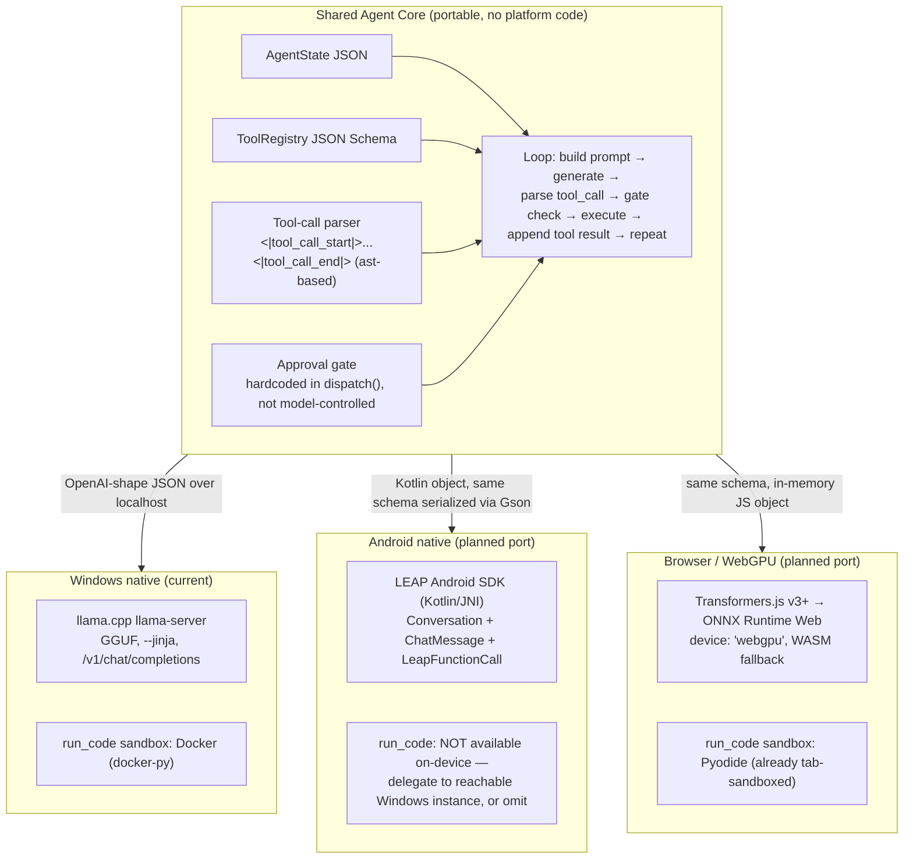
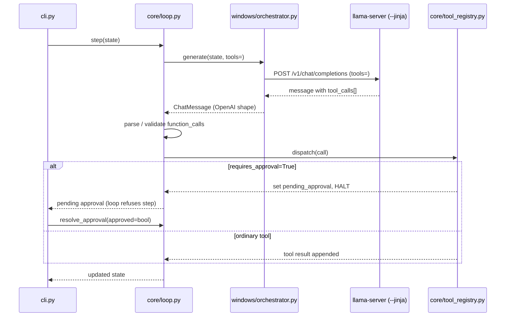

# Architecture

One model family (LFM2.5), three runtimes, one shared JSON contract. The core is portable; platforms are thin adapters.

## System diagram



**Rule:** the agent loop, tool registry, state machine, and **approval gate** live in the Core and are transport-agnostic. Each platform only implements a thin adapter that turns `AgentState → provider request` and `provider response → parsed ToolCall[]`, plus its own `run_code` sandbox backend.

## Build order (forced by dependency)

```mermaid
graph LR
    P0["Phase 0 — Core<br/>AgentState + parser + registry + approval gate"] --> P1["Phase 1 — Networked tools<br/>search, email, messaging (MCP-remote)"] --> P2["Phase 2 — Local doc-gen<br/>docx/pptx"] --> P3["Phase 3 — Code execution + sandbox<br/>highest-risk, own subsystem"] --> P4["Phase 4 — Cross-platform parity<br/>Android + WebGPU ports"] --> P5["Phase 5 — Cognitive layer<br/>identity, memory, planning, reflection"] --> P6["Phase 6 — Context window<br/>token budget for long/resumed sessions"] --> P8["Phases 8–9 — Commands + permission modes + file tools"] --> P10["Phases 10–11 — Sub-agents, skills, compaction, tasks"]
```



## Module layout

```
agent-core/
  schemas/                 # authoritative JSON Schemas (contracts)
    tool_definition.schema.json
    chat_message.schema.json
    agent_state.schema.json
  core/                    # portable agent core (Python, no platform code)
    __init__.py
    state.py               # pydantic AgentState / ChatMessage / PendingApproval / Plan
    parser.py              # ast-based Pythonic tool-call extraction, no eval (stdlib only)
    tool_registry.py       # schema validation on register(), approval gate + permission modes in dispatch()
    loop.py                # step() / resolve_approval() / retry-once, platform-agnostic
    context.py             # token budget: estimate_tokens (chars/4) + trim_to_budget (Phase 6)
    meta.py                # AGENT_NAME, agent_bio, inspect_self (Phase 5 identity)
    memory.py              # ~/.agent-core/memory/ JSON store, traversal guard, bounded recall
    planner.py             # make_plan / update_plan on AgentState.plan
    reflection.py          # lessons + Phase 11 automatic memory extraction (extract_memories)
    commands.py            # Phase 8: shared slash-command table (CLI + web consume it)
    telemetry.py           # Phase 12: usage records (TurnUsage on AgentState.usage) + /doctor probes
    subagent.py            # Phase 10: bounded one-level sub-agent (spawn_subagent)
    tasks.py               # Phase 11: durable task backlog (create/update/list/render)
  tools/                   # real tool handlers
    registry.json          # all tool definitions (echo, run_code, networked, email, doc-gen, cognitive, files, autonomy)
    remote.py              # McpClient — stdlib JSON-RPC MCP tools/call transport (portable)
    __init__.py            # register_web_tools / register_email_tools / register_networked_tools / register_docgen_tools / register_runcode_tool / register_cognitive_tools / register_files_tools / register_skills_tools / register_task_tools / register_subagent_tool
    cognitive.py           # state-aware handlers: inspect_self / remember / recall / make_plan / update_plan
    files.py               # Phase 9: read_file / write_file / edit_file / list_dir / glob / grep (rooted)
                           #   + sensitive-file guard: SENSITIVE_PATTERNS/sensitive_match() refuses
                           #   .env/key/credential reads (read_file, edit_file) and skips them in grep;
                           #   AGENT_CORE_FILE_ALLOW_SENSITIVE=1 = explicit override per invocation
    skills.py              # Phase 10: run_skill / list_skills (tool allowlist)
    subagent.py            # Phase 10: the `agent` tool (transport-registered; needs a provider)
    tasks.py               # Phase 11: task_create / task_update / task_list
    create_docx.py         # python-docx handler (Phase 2)
    create_pptx.py         # python-pptx handler (Phase 2)
    run_code.py            # Docker sandbox handler, watchdog timeout (Phase 3); hardened:
                           #   pids_limit 64, read_only + /tmp tmpfs, cap_drop ALL,
                           #   security_opt no-new-privileges, 100k-char output cap,
                           #   images pinned to manifest digests (_PINNED_DIGESTS)
  windows/                 # Windows transport (llama.cpp) — Phase 4
    server_config.ps1      # llama-server launch params
    orchestrator.py        # LlamaCppProvider: AgentState → OpenAI v3 request → ChatMessage
  cli.py                   # REPL: renders AgentState, streams text, runs core.commands
  Core-agent.bat           # one-click launcher: llama-server + Docker check + web UI + browser
  web/                     # Web UI + agent API server (stdlib only)
    server.py              # ThreadingHTTPServer; SSE API (token/tool_call/approval/done); sessions
                           #   trust boundary: local-only, NOT authenticated (Host/Origin loopback
                           #   checks = CSRF/DNS-rebinding defense, not auth; body-size cap;
                           #   /api/file mutations use one-time exact-argument confirm tokens)
    index.html             # SPA shell
    style.css              # dark local-first theme (approval amber, tool gray)
    app.js                 # renders AgentState, tool cards, approval modal, session sidebar, slash commands
    commands.js            # Phase 8 JS port of core/commands.py (browser worker + Node tests)
  web/context.js           # JS port of core/context.py (Phase 6, incl. Phase 11 compaction)
  web/engine.js            # in-browser loop, JS port of core/loop.py (+ plan/retry/lesson/allowlist)
  web/memory.js            # JS port of core/memory.py (localStorage/IndexedDB backend)
  web/planner.js           # JS port of core/planner.py
  web/subagent.js          # Phase 10 JS port of core/subagent.py
  web/skills.js            # Phase 10 JS port of tools/skills.py
  web/tasks.js             # Phase 11 JS port of core/tasks.py
  web/telemetry.js         # Phase 12 JS port of core/telemetry.py (usage summary + /cost text)
  web/worker.js            # module worker: Transformers.js + Pyodide + browser tools
  core/sessions.py         # shared session lifecycle: system prompt, save/load/list/delete
  android/                 # planned port — structure reserved
    AgentCore.kt           # Kotlin port of core/ control flow
  test_smoke.py            # Phase 0 smoke test (approval gate + retry-once + reflection)
  test_networked_tools.py  # Phase 1 (stdlib mock MCP-remote)
  test_docgen_tools.py     # Phase 2 (real .docx/.pptx round-trip)
  test_runcode.py          # Phase 3 (fake docker client)
  test_files.py            # Phase 9 (tempfile root; approval + traversal)
  test_orchestrator.py     # Phase 4 (stubbed OpenAI client)
  test_web.py              # Web UI (fake provider + ephemeral server)
  test_context.py          # Phase 6 (token budget invariants) + Phase 11 compaction
  test_memory.py           # Phase 5 (memory persistence + traversal guard) + Phase 11 extraction
  test_planner.py          # Phase 5 (plan create/update/serialize)
  test_meta.py             # Phase 5 (bio block + inspect_self accuracy)
  test_subagent.py         # Phase 10 (bounded sub-agents, approval bubbling, one-level)
  test_skills.py           # Phase 10 (tool allowlist; gate still applies)
  test_tasks.py            # Phase 11 (task backlog + session persistence)
  test_telemetry.py        # Phase 12 (usage records, /cost formatting, doctor probes — all faked)
  requirements.txt         # pydantic, jsonschema, python-docx, python-pptx, docker, openai
  docs/                    # this documentation set
  models/                  # GGUF weights (gitignored)
  vendor/                  # llama.cpp binaries (gitignored)
```

## Data flow (Windows path, Phase 4)



## Permission modes (Phase 8)

`AgentState.permission_mode` (`default | plan | auto | strict`) is enforced inside
`ToolRegistry._requires_approval()` ? the only place a call is parked. The hardcoded
`HARDCODED_APPROVAL_TOOLS` check (`run_code`) runs first, so no mode can bypass it:
only `resolve_approval(approved=True)` executes a parked `run_code` call.

| Mode | Behavior |
|---|---|
| `default` | park `requires_approval` tools, run the rest |
| `plan` | run only `read_only` tools, park everything else |
| `auto` | auto-approve gated tools except `run_code` |
| `strict` | park every tool call |

The web/browser mirror is `requiresApproval()` in `web/engine.js`; the mode is a
per-session setting (`POST /api/sessions`, the sidebar selector, `/mode`) that
serializes with the session.

## Approval gate (enforced in code, not convention)

1. Model emits `run_code(...)`.
2. `dispatch()` sees `requires_approval=True` → sets `AgentState.pending_approval`, loop halts.
3. UI surfaces the pending call to the human.
4. `resolve_approval(state, registry, approved=bool)` — only on `approved=True` does the Docker container / Pyodide worker actually run.

`pending_approval` is non-null exactly when a `requires_approval` tool call is waiting. The loop refuses to `step()` again until `resolve_approval()` clears it.

## Cognitive layer (Phase 5)

The agent gets a brain and a self. Everything is core-level, stdlib-only, and transport-agnostic — the web/Android targets reuse the same contract (JS ports: `web/memory.js`, `web/planner.js`, plus plan/retry/lesson in `web/engine.js`).

- **Identity:** `core/meta.py` owns the single shared constant `AGENT_NAME = "Agent Core"`. `agent_bio(state, registry)` produces the identity block (name, target, model, context + turn budgets, live tool list) injected as a system message at session creation (CLI, web SSE server, and `web/worker.js`), so "who are you / what can you do" is answered from fact. `inspect_self` (no approval) returns a live snapshot.
- **Memory:** `core/memory.py` stores one JSON file per key under `~/.agent-core/memory/` with the same traversal guard as sessions. `remember` / `recall` (no approval) read/write persistent facts, preferences, and lessons; `new_agent_state()` seeds each session with a bounded recall (≈512 tokens, newest first).
- **Planning:** `AgentState.plan` (`{goal, steps:[{id, description, status, result}]}`) with `make_plan` / `update_plan` (no approval). Plan steps are **bookkeeping only** — each step that calls a tool still hits the hardcoded approval gate independently; there is no plan-based approval bypass.
- **Reflection + retry-once:** `core/reflection.py` writes a one-line `kind=lesson` memory on terminal turns when a tool failed or the user rejected a call. `core/loop.py` implements retry-once: after a tool failure the loop allows exactly one more generate+execute cycle per user turn (`RETRY_ONCE_LIMIT = 1`, `retry_count` reset on each new user message), then gives up cleanly. A rejected call is never auto-retried — `resolve_approval(approved=False)` stays the only way through.

State-aware tool handlers are marked with `takes_state` and invoked as `handler(state, arguments)`; `ToolRegistry.execute(call, state=None)` remains backward-compatible for plain handlers.

## Autonomy (Phases 10–11)

- **Sub-agents:** `core/subagent.spawn_subagent` runs a nested `core.loop.run` with an isolated message list and its own bounded turn budget (`MAX_SUBAGENT_TURNS = 4`). It is **one level deep, one at a time** (`MAX_CONCURRENT_SUBAGENTS = 1`; the child is seeded with the cap so a nested `agent` call is refused). A gated tool inside the child stops it and returns the pending call; the `agent` tool sets `parent_state.pending_approval` and `loop.step` breaks (remaining calls stay in `pending_calls`), so the human still resolves it and `run_code` is never auto-approved. The `agent` tool is transport-registered (`cli.py`, `web/server.py`) because it needs a provider.
- **Skills:** `tools/skills.py` loads `skills/*.json` (`{name, description, prompt, tools?}`). `run_skill` injects the prompt and sets `AgentState.tool_allowlist`, enforced as a **denial** in `dispatch()` and cleared at the next user turn. It is a restriction, never a permission bypass — allowed calls still hit the gate. The browser mirrors this and fetches skills from `GET /api/skills`.
- **Compaction:** `core/context.compact_to_budget` replaces whole dropped turns with one `"Summary of earlier conversation:"` system message via one extra generate; opt-in in `LlamaCppProvider` (`AGENT_CORE_COMPACT=1`). `trim_to_budget` still guarantees the live turn is kept and tool/assistant pairs never split.
- **Memory extraction:** `core/reflection.extract_memories` proposes deduped `fact`/`preference` memories each terminal turn (heuristic, exception-safe, bounded) — extending Phase 5's lesson-only reflection.
- **Tasks:** `core/tasks.py` + `AgentState.tasks` is a durable backlog distinct from `plan`, managed by `task_create`/`task_update`/`task_list` and `/tasks`, serialized with the session.
- **Observability (Phase 12):** `core/telemetry.py` records one `TurnUsage` into `AgentState.usage` per provider generate (`record_usage`, called by `LlamaCppProvider` with the server-reported tokens it already captures) and `session_usage(state)` folds it for `/cost` (tokens-only — local inference is never metered) and the `#usage-line` sidebar readout; `/doctor` probes llama-server `/health`, the `/v1/models` model/ctx match vs `EXPECTED_CTX_BY_MODEL`, Docker for `run_code`, and session/memory dir writability, with every probe injectable so tests run without a live server. `inspect_self` reports the usage summary too. Pure logic mirrors to `web/telemetry.js`; `/doctor` is host-only in the browser.

## Sandbox decisions (Phase 3)

| Tool | Windows | Android | WebGPU |
|---|---|---|---|
| create_docx | python-docx | Apache POI (heavy — reconsider for v1) | docx.js |
| create_pptx | python-pptx | Apache POI (heavy — reconsider for v1) | pptxgenjs |
| run_code | **Docker** (docker-py, `--network none` + limits) | **None** (delegate to Windows or omit) | **Pyodide** (tab-sandboxed) |

### run_code Docker hardening (2026-10-20)

The approval gate is the human control; the container itself now also carries defense-in-depth:

| Limiter | docker-py kwarg | Default |
|---|---|---|
| Network isolation | `network_disabled=True` | on |
| Memory | `mem_limit` | 256m |
| CPU | `nano_cpus` | 0.5 CPU |
| Process count (fork bombs) | `pids_limit` | 64 |
| Root filesystem | `read_only=True` + `tmpfs={"/tmp": ""}` (scratch pages count against the memory cgroup) | on |
| Capabilities | `cap_drop=["ALL"]`, `security_opt=["no-new-privileges:true"]` | on |
| Timeout | watchdog thread kills the container | 30s |
| Output | truncation at `max_output_chars` with a marker | 100 000 chars |
| Supply chain | images pinned to manifest-list digests (`_PINNED_DIGESTS`, `default_images()`) rather than mutable tags | on |

All knobs injectable via `make_handler(...)` / `{docker_client, **kwargs}` on `register_runcode_tool`; the fake-client tests assert the full kwarg set so no flag silently disappears. Live-verified against Docker 28.5.1: pinned digest runs, `/tmp` writable + `/usr` read-only (OSError), fork loop stopped by `pids_limit`, 300k print truncated at 100k chars.

## Model selection (research doc §2)

Start with **LFM2.5-1.2B-Instruct** everywhere — one model, one prompt format, one set of quirks across all targets. Split models per platform only after measured data justifies it.

| Model | Target | Notes |
|---|---|---|
| LFM2.5-1.2B-Instruct | Windows default, Android mid-tier | native tool-calling; **the default** |
| LFM2.5-1.2B-Thinking | multi-step planning | higher latency; don't default |
| LFM2.5-2.6B | Windows daily-driver | needs ~8GB laptop/desktop |
| LFM2.5-8B-A1B (MoE) | Windows power tier / WebGPU | big first-load download |
| LFM2.5-350M / 230M | WebGPU / low-RAM | needs fine-tune to be usable for tools |

## Protocol decision

LFM2.5 emits native **Pythonic** calls (`func(arg="value")`) between the sentinel tokens. `core/parser.py` uses Python's `ast` module to extract them safely (no eval). On Windows, `--jinja` handles parsing natively; the parser covers raw paths (WebGPU, fallbacks).
